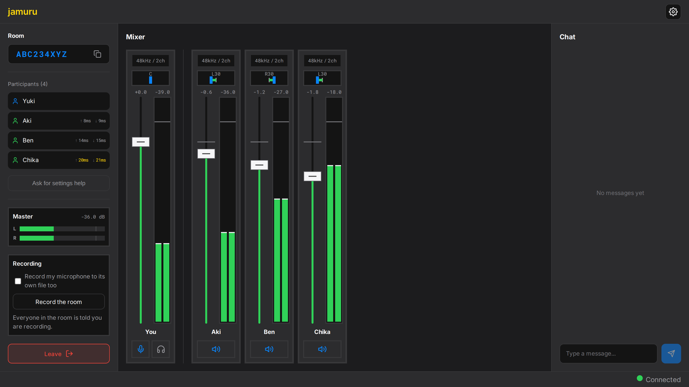

<div align="center">

# jamuru

**Low-latency, uncompressed peer-to-peer audio for musicians playing together over the internet.**




[Install](#install) · [Highlights](#highlights) · [Documentation](#documentation) · [Development](#development) · [License](#license)

</div>

Open a room, send the 9-character invite code to your bandmates and play. Audio goes straight between your computers, uncompressed, so the delay you hear is close to the network round trip and little else. The screenshot above is drawn from sample data.

## Highlights

- **Uncompressed by default.** Audio is sent as 24-bit PCM at 44.1, 48 or 96 kHz, packed without loss. No lossy codec sits between you and your bandmates.
- **Built around delay.** The design target is under 2 ms of delay added by the app itself, one way, so the delay is mostly your network (about 10-25 ms RTT on a domestic fibre line).
- **Direct connections.** Audio flows peer to peer; no central server carries it.
- **A mixer for the room.** Each participant gets a fader, pan and level meter, and you can record the room.
- **Three desktop platforms.** macOS, Windows, and Linux including 64-bit ARM; the command-line tool also runs on 32-bit ARM Linux.

## Install

Use the official binaries; the [LICENSE](./LICENSE) does not permit building from source.

- Download the installer for your platform from [GitHub Releases](https://github.com/koedame/jamuru-client/releases). Every release is currently a pre-release (beta).
- On macOS with Homebrew: `brew install --cask koedame/tap/jamuru@beta`

See [docs/getting-started/installation.md](./docs/getting-started/installation.md) for system requirements, the warning shown for unsigned apps, ARM Linux and automatic updates, then the [quick start](./docs/getting-started/quick-start.md) for your first session.

## Documentation

- [Installation](./docs/getting-started/installation.md)
- [Quick start](./docs/getting-started/quick-start.md)
- [Troubleshooting](./docs/getting-started/troubleshooting.md)
- [Privacy](./docs/getting-started/privacy.md)
- [Terms of use](./docs/terms.md)
- [Announcements](./docs/announcements.md)

## Development

This section is for the copyright holder's development work. The [LICENSE](./LICENSE) does not permit anyone else to build or run the software from source; use the official binaries from [GitHub Releases](https://github.com/koedame/jamuru-client/releases) (see [Install](#install)).

### Quick Start

```bash
# Install Rust
curl --proto '=https' --tlsv1.2 -sSf https://sh.rustup.rs | sh

# Clone the repository
git clone https://github.com/koedame/jamuru-client.git
cd jamuru-client

# Build core library
cargo build

# Run tests
cargo test
```

### Running the Desktop App (Tauri)

```bash
# Run from project root (not src-tauri directory)

# Development mode (frontend server starts automatically).
# Needs the Tauri CLI (`cargo install tauri-cli --version "^2"`) and, on Linux, system
# libraries such as libasound2-dev and libwebkit2gtk-4.1-dev
cargo tauri dev

# Production build (pass the server the app asks for its signaling server)
JAMJAM_SERVER_URL=https://<jamuru server> cargo tauri build
```

The built application will be in `src-tauri/target/release/bundle/`.

## License

**Source Available License (Not Open Source)**

This software is released under a custom Source Available license. The source code is publicly available for transparency purposes, but usage is restricted:

- **Permitted**: Viewing source code, using official binaries
- **Not Permitted**: Modification, redistribution, providing it as a service to others, building from source, creating competing products

See [LICENSE](./LICENSE) for full terms and [THIRD_PARTY_LICENSES.md](./THIRD_PARTY_LICENSES.md) for third-party component licenses.

## Trademarks

ASIO is a trademark of Steinberg Media Technologies GmbH. jamuru is not affiliated with or endorsed by Steinberg. All other product names are the property of their respective owners.
