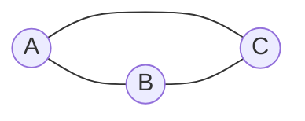
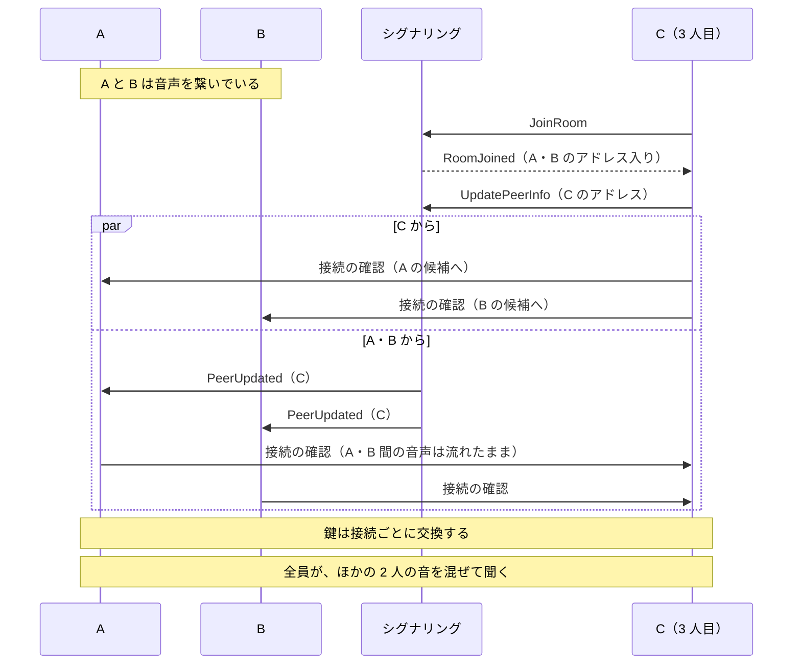

# ADR-077: ルームの参加者は全員と音声を繋ぐ。相手ごとの接続は 1 つの音声ソケットを共有する

## Status

Accepted。§4（セッションの始まりと終わり）は [ADR-083](./ADR-083-audio-session-runs-from-entering-the-room.md) が置き換えた

## Context

3 人でルームに入ると、3 人目は誰の音も聞こえず、誰にも聞こえなかった。画面には参加者 3 人とミキサーの列 3 本が出て、3 人目には
「接続が切断されました。再接続しますか？」が出る。再接続を押しても変わらない。

| 誰 | ルームに見える相手 | 音声の相手 | 接続の状態 | 聞こえた音 |
|----|-------------------|-----------|-----------|-----------|
| A（作った） | B・D | B | connected | B だけ |
| B（2 人目） | A・D | A | connected | A だけ |
| D（3 人目） | A・B | B（B は A と繋いでいる） | failed | なし |

仕様は 3 人以上をフルメッシュ P2P と決めている（[architecture.md](../architecture.md) §7.2、REQ-CON-020 の上限 10 人）。実装が 1 対 1 のままで、
[ADR-026](./ADR-026-gui-audio-path.md) は多人数を対象外とし、[ADR-068](./ADR-068-follow-the-peer-after-rejoin.md) と
[ADR-044](./ADR-044-portals-and-permissions.md) §6 はその 1 対 1 を前提に書かれていた。1 対 1 に固定していたのは次の 4 か所。

1. **名簿**: 音声の相手を 1 人だけ持つ（`Roster::streaming_with: Option<Uuid>`）。すでに誰かと繋いでいれば、ほかの人がアドレスを公開しても何もしない。
2. **ソケット**: 接続（`Connection`）が音声ソケットを 1 つ独占し、受信を自分で読む。音声アドレスは参加者ごとに 1 つ（ルームに公開した 1 組）なので、
   2 本目の接続を同じソケットに載せると、互いのパケットを取り合う。
3. **再生**: 出力コールバックが読む再生バッファ（`ReceivePath`）が 1 つ。
4. **ミキサーと状態**: エンジンに渡る音量・パンは 1 組、`streaming_status` の接続状態・統計も 1 組。画面は全員の行に同じ値を出していた。

## Decision

### 1. アドレスを公開した参加者の全員に、1 本ずつ音声を繋ぐ

名簿（`Roster`）は、アドレスを公開している参加者それぞれに `Audio::Start` を出す。あとから公開した人にも、その時点で出す。本数の上限は
9 本（ルームの上限 10 人から自分を引いた数）。サーバーが切断に気づく前のエントリが残って 10 人以上が載ったときは、先頭から 9 人に繋ぎ、
誰かが退室して空いたら次の人に繋ぐ。

3 人なら 3 本、10 人なら 45 本（1 人あたり 9 本）になる。

### 2. 音声ソケットは参加者ごとに 1 つ。届いたパケットを送り元のアドレスで相手ごとの接続に振り分ける（`UdpMux`）

ルームにいる全員が、公開された 1 つのアドレスへ送る。そのソケットを読むのは `UdpMux` だけで、相手ごとの接続は
`Connection::on(&mux)` で作り、送信はソケットに直接、受信は `UdpMux` から受け取る（REQ-CON-033）。

- 接続は、接続の確認を始めるときに相手の候補アドレスを `UdpMux` に届ける。そのアドレスから来たパケットは、その接続にだけ渡る。
- 2 人の相手が同じアドレスを公開している（別々の家で同じプライベートアドレスになる）ときは、両方の接続に渡す。
- どの相手のアドレスでもないところから来たパケットは、全部の接続に渡す。相手の外から見えるアドレスが途中で変わっても、その相手との鍵で
  開ければ受け取れる（接続がソケットを独占していたときと同じ）。鍵が合わない接続は捨てる。
- 始まる前と終わった後の接続には何も渡さない。

相手ごとにソケットを分ける案は採らない。音声アドレスを相手ごとに公開する必要があり、シグナリングのメッセージの形（`UpdatePeerInfo` は
ルーム全体に 1 組）と、NAT の割り当ての数（相手の数だけ STUN に聞く）が変わる。

### 3. 相手ごとの接続は、これまでの `Connection` をそのまま使う

接続の確認（候補ごとの往復時間）・鍵の交換と相手の確認・FEC・ロスの計測・RTT・無音の検知と再接続は、相手ごとに要る。どれも
`Connection` が持っているので、接続を相手の数だけ作る。使っていなかった複数人用の部品（`Session`）は、これらを持たないので使わない。

### 4. 音声のセッションは最初の 1 本で始まり、最後の 1 本が終わると止まる

デバイスとソケットは、最初の `Audio::Start` で開く（`streaming_link`）。2 本目からは、動いているセッションに「繋ぐ」
（`StreamingCommand::Link`）・「閉じる」（`Unlink`。`Audio::End`）を指示する。最後の 1 本の相手が退室すると、これまでどおりセッションを
止めて音声アドレスを公開し直す（`Audio::Stop`・`Audio::Advertise`）。

接続の確認は 1 本ごとに別のタスクで走る。確認には 0.5〜2.5 秒かかるので、音声スレッドのループの中で待つと、その間ほかの相手の統計と
操作（停止・ミュート）が止まる。確認が終わった接続から、送信の対象に加える。

### 5. 再生は、相手ごとの再生バッファを出力コールバックで足し合わせる（`PeerMix`）

相手ごとに `ReceivePath`（復号・サンプルレート変換・再生バッファ・補間）を持ち、出力コールバックが 1 フレームぶんずつ読んで、
その相手の音量・パン・ミュートを掛けてから足す。

- **相手ごとにフレームの長さが違う。** 相手のバッファサイズとサンプルレートで決まるので（REQ-AUD-038）、相手ごとに読み残しを持ち、
  自分の 1 フレームに足りるまで読んで、余りは次のフレームに回す。全員が同じ設定のときは、これまでと同じく 1 回の読み出しがそのまま 1 フレームになり、
  読み残しは出ない（遅延は増えない）。
- **足し合わせに自動の音量調整を入れない。** 人数で割る・リミッタを掛ける処理は、1 人の音量がほかの人の出入りで変わり、波形も変える。
  音量は参加者ごとのフェーダーとマスターで決める。
- 置き場は 9 個で固定。出力コールバックはロックを待たず、ちょうど出し入れしている最中の 1 人は、その 1 フレームだけ足さない
  （ほかの人の音には触れない）。

### 6. 送信は、取り込んだ 1 フレームを全員の接続へ送る

暗号化は接続ごと（相手ごとの鍵）なので、同じフレームを相手の数だけ封をして送る。上りと下りの帯域は相手の数に比例する。
1 本あたりの必要帯域（`required_bps`。48 kHz・ステレオ）はプリセットで 3.5〜4.1 Mbps なので、10 人のルームでは 1 人あたり
上り・下りとも 31〜37 Mbps になる。回線が足りない相手は、これまでどおり相手ごとの帯域の判定（REQ-LAT-127）で画面に出る。

| プリセット | 1 本あたり | 3 人（2 本） | 10 人（9 本） |
|-----------|-----------|-------------|--------------|
| zero-latency | 3.84 Mbps | 7.7 Mbps | 34.6 Mbps |
| ultra-low-latency | 3.46 Mbps | 6.9 Mbps | 31.1 Mbps |
| balanced | 4.08 Mbps | 8.2 Mbps | 36.7 Mbps |
| high-quality | 3.67 Mbps | 7.3 Mbps | 33.0 Mbps |

### 7. 相手との音声が途切れたら、その相手だけを扱う（REQ-CON-134）

音声の状態は接続ごとに名簿へ伝える（`Roster::link_is`）。

- 途切れた（2 秒）・諦めた（10 秒）接続の相手が、別のアドレスを公開していれば、その相手との接続だけを張り直す。まだ一度も音が届いていない
  接続も同じ（応えないアドレスで始めていた）。自分の音声アドレスは変わらない（ソケットはほかの接続が使い続けている）。
- 諦めた接続があり、**誰の音も届いていない**ときは、ルームを出て入り直す（`Audio::Rejoin`。新しい音声アドレスを公開する）。誰の音も届かないまま
  入り直すのは 3 回まで。誰かの音が届いていれば入り直さない: 入り直すと全員との音声が数秒止まり、1 本の経路の不調には効かないことが多い。
- 「音が届いた」は、接続が立ち上がったことではなく、相手のパケットを受け取ったこと。接続の確認に応えが無くても接続は最初の候補で立ち上がるので
  （相手があとから応える場合のため）、立ち上がりを「届いた」に数えると、居ない相手に対して入り直しを繰り返す。

[ADR-068](./ADR-068-follow-the-peer-after-rejoin.md) の決定 2（音声を別の参加者へ移す）と決定 3（移すときに同じポートを取り直す。
`Audio::KeepAddress`）は、移す先がいつも繋がっているので要らなくなり、取り除く。入り直した参加者の新しいエントリには、アドレスが公開された時点で
繋ぐ。決定 5（諦めたのに移る先がないときは入り直す）は、条件を上のとおり「諦めた接続があり、誰の音も届いていないとき」に改めて引き継ぐ。
3 回までの数え直しは、接続が立ち上がったときではなく、相手の音が届いたときに行う（立ち上がりで数え直すと、居ない相手に対して上限が効かない）。
決定 1（自分の旧エントリを外す。REQ-CON-130）と決定 4（止めるときは音声のスレッドの終わりを待つ）は残る。

### 8. ミキサーと状態は参加者ごと

- 参加者ごとのフェーダー（音量・パン・ミュート）は、音声を繋いでいる全員に効く。動かしたときにエンジンへ渡し、まだ繋いでいない人の分は
  繋いだときから効く（[ADR-044](./ADR-044-portals-and-permissions.md) §6 の「音声の相手のストリップだけ」を置き換える）。
- `streaming_status` の `peers` に、接続ごとの状態・統計・遅延の内訳・相手の音声の設定・再生レベルを返す（REQ-LAT-102）。
  これまでの 1 組の項目（`network`・`latency`・`peer_audio`・`connection_state`・`connection_error`）は、いちばん良い状態の接続
  （同じなら先に繋いだもの）の値を返す。2 人のルームでは相手との接続そのものなので、2 人用に書かれた読み手はそのまま読める。
  相手のアドレスは返さない（`remote_addr` を取り除いた）。
- セッションの状態は `streaming_peer_ids`（音声を繋いでいる参加者）を返す。`streaming_peer_id` はその先頭。
- 画面は、接続の表示を参加者ごとに出す。全体の表示は、いちばん悪い接続に合わせる。
- 利用状況の記録の形は変えない。RTT とロスは全部の接続を標本にし、接続の立ち上がり方は最初に立ち上がった 1 本を記録する。
- 録音・配信用の仮想出力の B は、ほかの全員の音（フェーダー前）の和にする。

### 9. CLI も同じ判断・同じ部品で全員と繋ぐ。判断と混合はコアに置く

CLI（`jamuru`）とアプリはどちらも画面・コマンドという入口であり、エンジンは共通にする。全員と繋ぐのに要る部品のうち、画面に依らないものは
コアのクレートに置き、アプリと CLI が同じものを使う。

| 部品 | 置き場 | 中身 |
|------|--------|------|
| `Roster`・`LinkHealth` | `src/network/roster.rs` | 誰と繋ぐか・抜けた相手・途切れた相手の判断（入出力なし）。`LinkHealth::of` が接続の状態と受信数から健全性を決める |
| `PeerMix`・`PeerGain`・`PeerMeter` | `src/audio/peer_mix.rs` | 全員の音を足し合わせる再生。音量・パンは参加者ごと |
| `UdpMux`・`Connection::on` | `src/network/udp_mux.rs` | 1 つの音声ソケットを相手ごとの接続で共有する |
| `gather_candidates_on` | `src/network/signaling.rs` | `UdpMux` が読み始める前に、公開するソケットで STUN に聞く |

CLI は `Roster` の答え（`Audio::Start`・`End`・`Stop`）を実行するだけで、判断を持たない。違いは入口に付くものだけである:

- 音声ソケットは CLI の間ずっと同じで、最初に 1 度公開する。最後の 1 本が終わっても作り直さないので、`Audio::Advertise` は何もしない
  （`Audio::Stop` は全部の接続を閉じる）。
- 全員の音声が途切れて誰の音も届かないとき、アプリは入り直す（`Audio::Rejoin`）。CLI は入り直さず、警告を出す。
- 接続の確認は相手ごとのタスクで走らせ、終わった接続から送信と再生の対象に加える（確認の間、ほかの相手の音とキー入力が止まらない）。
- `/stats` と終了時の統計は相手ごとに出す。`--report-json` の `peer`・`network`・`playout` は最初に繋いだ相手のもので、2 人のルームでは相手そのもの。
  全員の値は `peers` に並ぶ。

## Consequences

- 3 人以上のルームで、全員が全員の音を聞ける。検証は、ループバック上の実ソケットで 3 人・10 人を繋ぐ結合テスト
  （`tests/mesh_connection_test.rs`）、名簿・混合・状態の単体テスト、実アプリ 3 台、実際の CLI を 3 つ立てて互いの音を聞かせる結合テスト
  （`tests/cli_test.rs`、REQ-CLI-011）。
- 定常の 1 対 1 の経路（接続の確認・送受信・再生バッファ・符号化）は変えていない。2 人のルームでは、ソケットの読み手が `UdpMux` になり、
  再生が `PeerMix` を通るだけで、読み残しが出ないので遅延は同じ。
- 帯域と、封をする・復号する処理は相手の数に比例する。
- **この変更より前の版のアプリ・CLI は 1 人としか繋がない。** 3 人以上のルームに古い版が混ざると、古い版は 1 人とだけ音声を繋ぎ、ほかの人からは
  「接続できない参加者」に見える。全員がこの変更を含む版である必要がある。
- 2 人の間の経路だけが通らない組（どちらかの NAT が相手を通さない）は、その 2 人の間だけ聞こえない。中継（TURN）を持たないので、
  ほかの人を経由して届けることはしない。画面にはその相手との接続が切れていると出る。

## 参照

- [ADR-026](./ADR-026-gui-audio-path.md): アドレスの交換（多人数を対象外としていた部分を本 ADR が置き換える）
- [ADR-028](./ADR-028-single-stage-playout.md): 出力コールバックが再生バッファから直接読む
- [ADR-064](./ADR-064-encrypt-the-audio-link.md)・[ADR-067](./ADR-067-check-the-peer-in-the-key-exchange.md): 接続ごとの鍵と相手の確認
- [ADR-068](./ADR-068-follow-the-peer-after-rejoin.md): 入り直しのあとの追従（決定 2・3 を本 ADR が置き換える）
- `src/network/udp_mux.rs`・`src/audio/peer_mix.rs`・`src/network/roster.rs`・`src-tauri/src/streaming.rs`・`src/main.rs`・`src/links.rs`（CLI）
- 要求: `REQ-CON-033`・`REQ-CON-133`・`REQ-CON-134`・`REQ-LAT-102`・`REQ-AUD-038`・`REQ-CLI-011`
