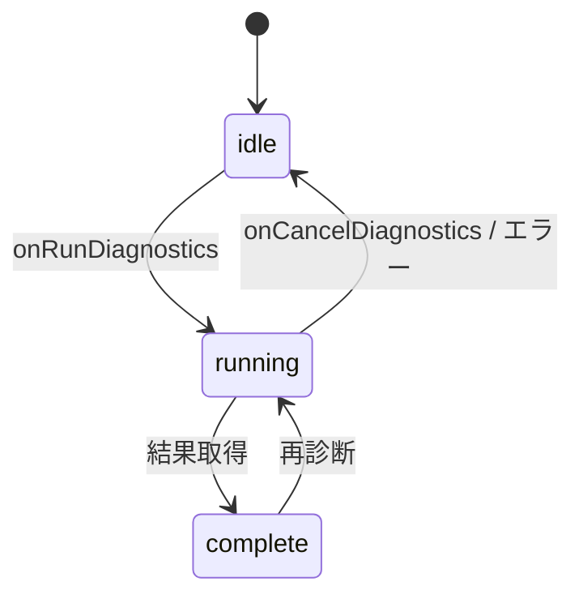

# SettingsPanel - 設定パネル

アプリケーション設定を管理するコンポーネント。
一般（プロフィール・言語・サーバー）・オーディオ・プライバシー・診断とサポート・アプリについて、の 5 つのタブを提供する。タブの分け方は [ADR-080](../../adr/ADR-080-settings-tabs-by-what-the-user-is-doing.md)。

デザインは `ui.pen`（Pencil schema 2.14）の `Screens/Settings` 系を正とする。
配色・タイポグラフィは `ui/src/styles/tokens.css` のトークンのみを使用する（ハードコード禁止）。

---

## 概要

### 目的
- アプリ全体の設定を1箇所で管理
- デバイス選択と音声設定の調整
- 診断機能によるネットワーク/デバイス/CPU環境チェックと、診断結果に基づく推奨プリセット（バッファサイズ）の適用

### 使用場面
- 初回起動時（デバイス選択）
- セッション前の設定確認
- トラブルシューティング時（診断）

---

## ビジュアル仕様

上部にヘッダー、その下に「左サイドバー（アイコン付き垂直タブ）＋右コンテンツ」を配置する。

```
┌──────────────────────────────────────────────────────────┐
│ 設定                                    ← Header (h56)     │  bg: --color-bg-secondary
├──────────┬───────────────────────────────────────────────┤
│ ≡ 一般    │  デバイス                    ← 見出し(Inter, bold) │
│ ◈ オーディオ│  入力デバイス                                    │
│ ◇ プライバ.│  ┌───────────────────────────────┐            │
│ ∿ 診断と.. │  │ Built-in Microphone        ▼ │            │  Select(block)
│ ⓘ アプリ.. │  └───────────────────────────────┘            │
│          │  ...                                            │
└──────────┴───────────────────────────────────────────────┘
   Sidebar(w200)          Content(flex, overflow-y:auto)
   bg:--color-bg-secondary
```

### 配色・寸法（tokens.css）

| 要素 | 値 |
|------|-----|
| パネル背景 | `--color-bg-primary` (#1C1C1E、`bg-page`) |
| ヘッダー / サイドバー背景 | `--color-bg-secondary` (#2C2C2E、`bg-card`。パネル背景より明るい) |
| 入力欄 / 選択欄 / タブ選択時の背景 | `--color-bg-tertiary` (#141414、`bg-row`。最も暗い recessed 面) |
| 罫線 | `--color-border` (#38383A), 1px |
| アクセント（選択タブのアイコン、値ハイライト、送信ステレオ、合計遅延、実行ボタン） | `--color-accent` (#0A84FF、`accent-blue`) |
| 見出しフォント | `--font-family-heading` (Inter) |
| 本文フォント | `--font-family-sans` (Inter) |
| 数値フォント | `--font-family-mono` (Roboto Mono) |
| 角丸 | ボタン/入力/バッジは `--radius-control`（8px）、カード/パネルは `--radius-card`（14px） |
| シャドウ | フォーカスリング（`--shadow-focus`）、ボタンは `--shadow-button` 程度の控えめな浮き上がり |
| ヘッダー高 | 56px |
| サイドバー幅 | 200px |
| タブ項目高 | 36px |

---

## コンポーネント構成

### SettingsPanel（コンテナ）

Pure コンポーネント（Tauri 非依存）。全データを Props で受け取る。

```typescript
type SettingsTabId = "general" | "devices" | "privacy" | "diagnostics" | "about";

interface SettingsPanelProps {
  initialTab?: SettingsTabId;          // 既定 "devices"（Adapter は "general"）
  title?: string;                      // ヘッダー題字（既定 i18n settings.title）
  language: Language;
  displayName: string;
  displayNameError?: string;
  inputDevices: DeviceInfo[];
  outputDevices: DeviceInfo[];
  selectedInputId: string | null;
  selectedOutputId: string | null;
  inputChannelOptions?: SelectOption[];
  outputChannelOptions?: SelectOption[];
  selectedInputChannelL?: string;
  selectedInputChannelR?: string | null;   // null/"" = モノラル
  selectedOutputChannelL?: string;
  selectedOutputChannelR?: string | null;
  sampleRateOptions?: SelectOption[];
  selectedSampleRate?: string;
  bufferSizeOptions?: SelectOption[];
  selectedBufferSize?: string;
  transmitChannelOptions?: SelectOption[];
  selectedTransmitChannels?: string;
  isLoading?: boolean;
  diagnosticsState?: "idle" | "running" | "complete";
  diagnosticsProgress?: number;             // 0-100
  diagnosticsProgressMessage?: string;
  diagnosticsResult?: CompleteDiagnosticsResult;
  onLanguageChange: (language: Language) => void;
  onDisplayNameChange: (name: string) => void;
  onInputDeviceChange: (id: string) => void;
  onOutputDeviceChange: (id: string) => void;
  onInputChannelLChange?: (value: string) => void;
  onInputChannelRChange?: (value: string) => void;
  onOutputChannelLChange?: (value: string) => void;
  onOutputChannelRChange?: (value: string) => void;
  onSampleRateChange?: (value: string) => void;
  onBufferSizeChange?: (value: string) => void;
  onTransmitChannelsChange?: (value: string) => void;
  onRunDiagnostics?: () => void;
  onCancelDiagnostics?: () => void;         // 指定時のみ実行中にキャンセルボタン表示
  onApplyPreset?: (preset: RecommendedPreset) => void;
  onOpenLogFolder?: () => void;             // 指定時のみ診断とサポートタブにログファイルの節を表示
  logFolder?: string | null;                // 開いたフォルダ（ボタンの下に表示）
  logFolderError?: string | null;           // 開けなかった理由（フォルダの場所を含む）
  previousHang?: Hang | null;               // 前回終了しなかった記録（無ければ節を出さない）
  onSendPreviousHang?: (send: boolean) => void; // 指定時のみ previousHang があれば節を表示
  previousHangAnswered?: boolean;           // 答えた後、節を短い確認表示に切り替える
  previousHangAttachesLog?: boolean;        // 「送る」が jamuru.log も添えるか（1.0.0 未満は true）
  usageReporting?: boolean;                 // 利用状況を送る設定（既定オフ）
  onUsageReportingChange?: (enabled: boolean) => void; // 指定時のみプライバシータブに利用状況の節を表示
  usagePreview?: string | null;             // 次に送る NDJSON（null = まだ見ていない）
  onShowUsagePreview?: () => void;          // 「送る内容を見る」
  usagePreviewError?: string | null;        // 保存や読み出しに失敗した理由
  reportProblemState?: ReportProblemState;  // 既定 "idle"
  reportProblemPreview?: string | null;     // 送る jamuru.log の内容（読み込み前は null）
  reportProblemComment?: string;
  reportProblemError?: string | null;       // 読み込み・送信に失敗した理由
  onOpenReportProblem?: () => void;         // 指定時のみ診断とサポートタブに「問題を報告」の節を表示。押すとログを読み込む
  onReportProblemCommentChange?: (value: string) => void;
  onSendReportProblem?: () => void;
  onCancelReportProblem?: () => void;       // ready/error から idle へ戻す（送信しない）
}

type ReportProblemState = "idle" | "loading" | "ready" | "sending" | "sent" | "error";

type Language = "ja" | "en";
```

**テーマ選択は廃止した。** jamuru は現状ダーク専用ブランドであり（`tokens.css` の light は dark を複製）、`ui.pen` の一般タブも言語のみを持つ。このため `theme` / `onThemeChange` は SettingsPanel から削除した。

タブは次の 5 つで、並びは使う頻度の順（よく触る設定 → 送信の判断 → 困ったとき → 情報）。各タブにアイコンを表示する。
`ui.pen` の設定画面（`Screens/Settings` の各フレーム）もこの 5 タブに合わせてある（[ADR-080](../../adr/ADR-080-settings-tabs-by-what-the-user-is-doing.md)）。
初期表示タブは一覧の並び順とは独立に `オーディオ`（`initialTab` のデフォルト値。設定ウィンドウは `一般` で開く）。
`legal`（規約などを開く関数）を渡さないとき、アプリについてのタブは出さない。

| タブ | id | lucide アイコン | 中身（見出し） |
|------|----|----------------|----------------|
| 一般 | `general` | `sliders-horizontal` | プロフィール（表示名）／表示（言語）／接続（サーバー） |
| オーディオ | `devices` | `mic` | デバイス／音質と遅延 |
| プライバシー | `privacy` | `shield` | 前回について／利用状況の送信 |
| 診断とサポート | `diagnostics` | `activity` | システム診断／ログファイル／問題を報告 |
| アプリについて | `about` | `info` | アップデート／規約など |

`devices` の id は DOM の id・E2E・設定の手伝い（ADR-044）が参照しているため、題を「オーディオ」に変えても変えない。

アイコンはライブラリ非依存の手書き SVG（`SettingsPanel/icons.tsx`）で、`currentColor` で色を制御する。

### VerticalTabs（垂直タブ）

```typescript
interface Tab { id: string; label: string; icon?: ReactNode; }
interface VerticalTabsProps {
  tabs: Tab[];
  selectedId: string;
  onSelect: (id: string) => void;
}
```

- 選択タブ: 背景 `--color-bg-tertiary` ＋ アイコン `--color-accent` ＋ ラベル `--color-text-primary`
- 非選択タブ: 背景透明 ＋ アイコン/ラベル `--color-text-secondary`（hover でラベルは primary）
- キーボード: ↑/↓ で移動（ラップ）、Home/End で先頭/末尾

### FormField

2種のレイアウトを持つ。

```typescript
interface FormFieldProps {
  label: string;
  htmlFor?: string;
  description?: string;   // row 時、ラベル下の補足
  hint?: string;          // stacked 時、コントロール下の補足
  error?: string;
  orientation?: "stacked" | "row";   // 既定 "stacked"
  children: ReactNode;
}
```

- `stacked`: ラベル（`--font-size-small` / secondary）を上、コントロールを下、hint をさらに下。デバイス／チャンネル／言語／表示名で使用。
- `row`: 左にタイトル（`--font-size-caption` / primary）＋ description、右にコントロール（`space-between`）。送信チャンネル／サンプルレート／バッファで使用。

### Select

ネイティブ `<select>` を透明（opacity 0）でフィールド全面に重ね、表示値とシェブロンを自前描画する。ネイティブのキーボード／スクリーンリーダー挙動を保ちつつ、フラットな見た目とアクセントの値表現を実現する。フォーカスは `:focus-within` で `--shadow-focus`。

```typescript
type SelectVariant = "block" | "inline" | "channel";
interface SelectProps {
  options: SelectOption[];
  value?: string;
  placeholder?: string;
  onChange?: (value: string) => void;
  disabled?: boolean;
  variant?: SelectVariant;   // 既定 "block"
  prefixLabel?: string;      // channel 用の内側ラベル
}
interface SelectOption { value: string; label: string; disabled?: boolean; }
```

| variant | 用途 | 高さ | 値の色/フォント |
|---------|------|------|----------------|
| `block` | 入力/出力デバイス・言語 | 40px | primary / sans |
| `inline` | サンプルレート・バッファ | 32px | accent / mono |
| `channel` | L/R チャンネル（内側に prefix ラベル） | 36px | primary / mono |

### Input

表示名入力。高さ40px、背景 `--color-bg-tertiary`、1px 罫線、フォーカスで `--shadow-focus`、error 時 `--color-danger` 罫線。

---

## タブ構成

### デバイスタブ（DevicesTab）

1. 見出し「デバイス」
2. 入力デバイス / 出力デバイス（`stacked` + `block` Select）
3. 入力チャンネル / 出力チャンネル（`stacked` + `channel` Select × 2。R に "なし"=モノラル）
4. 区切り線
5. 見出し「音質と遅延」
6. 送信チャンネル（`row` + セグメントトグル モノラル/ステレオ。選択側は `--color-accent` 罫線＋文字）
7. サンプルレート / バッファサイズ（`row` + `inline` Select）
8. WASAPI のモード（Windows で WASAPI のデバイスがあるときだけ。下記）
9. 遅延サマリーカード（下記）

#### WASAPI のモード

設定の応答に `wasapi` があるとき（Windows で、WASAPI のデバイスがあるとき）だけ出す（REQ-GUI-031、ADR-088）。

- 見出し「WASAPI のモード」と説明 1 行の下に、モードごとのカード（`fieldset` の中の `radio`）を 3 枚: 共有モード（標準）・共有モード（低遅延）・排他モード
- カードの 1 行目は、モード名・判定のバッジ（推奨 `--color-success` / 非推奨 `--color-warning` / 使えません `--color-text-secondary`）・右端に周期（「周期 10.0ms」。入力と出力で違えば両方）。2 行目に判定の理由
- 排他モードのカードには、ほかのアプリがそのデバイスで音を出せない（Windows の既定の設定では、先に鳴らしているアプリの音も止まる）という注意書きを `--color-warning` で添える（使えないときは出さない。ただし選んだまま一部の側だけ排他モードで開くときは出す）
- 選んでいるカードは罫線を `--color-accent` にする。使えないモードは選べない（`disabled`。保存してあるモードが使えなくなったときは、選んだまま表示する）
- 入力も出力も ASIO のとき（`advice.applies` が false）は、カードを出さず、モードが使われないことを説明 1 行で出す
- 選ぶと `settings_change` の `{"setting": "wasapi_mode", "mode": ...}` を渡す

#### 遅延サマリーカード

現在のバッファサイズ・サンプルレートからアプリ起因の片道遅延を算出して表示する。

- 片道遅延[ms] = `bufferSize / sampleRate * 1000`
- WASAPI のモードが使われるときは、側ごとに、片道遅延と選んだモードでその側が動く周期の長い方（選んだモードで開けない側は標準の共有モードの周期。周期が分からない側は片道遅延のまま）
- 入力遅延・出力遅延 = 上の値（各々小数第1位に丸め）
- 合計遅延 = 丸め後の入力＋出力（表示の整合を保つ）
- 色: 片道 ≤3ms は `--color-success`、≤6ms は `--color-warning`、それ以上は `--color-danger`。合計は常に `--color-accent`

（アプリ起因の片道遅延目標 `<2ms` は ADR-008 準拠。バッファ64/48kHz で約1.3ms。）

### 一般タブ（GeneralTab）

アプリ全体と利用者自身についての設定。節の間は区切り線で分ける。

1. 見出し「プロフィール」: 表示名（`stacked` + Input、hint「他の参加者に表示される名前です（1〜32文字）」、最大32文字、空は error）と、その下のスイッチ「入室前に名前を確認する」（hint「ルームを作る・入るたびに、使う名前を確かめます」。既定はオン。オフにするのは入室前の名前の確認の「次からこの名前を使用する」と同じ設定で、オンに戻すとまた確認が出る。`config_set_ask_name_on_entry` でその 1 項目だけを変える。REQ-CON-142）
2. 見出し「表示」: 言語（`stacked` + `block` Select: 日本語 / English）
3. 見出し「接続」: サーバー（`stacked` + Input。空なら既定のサーバーを使い、hint に実際の接続先を出す）

### プライバシータブ（PrivacyTab）

データを送るかどうかの判断を集める。診断の機能とは別の場面（送信を止めたい・内容を確かめたい）で開かれる。節の仕様は診断タブの記述の「前回についての節」「利用状況の節」と同じ（i18n キーは `settings.privacy.*`、`data-testid` は `privacy-*`）。

- **前回についての節**（`onSendPreviousHang` 指定かつ `previousHang` があるときだけ。先頭）
- **利用状況の節**（`onUsageReportingChange` 指定時のみ）

### アプリについてタブ（AboutTab）

先頭に**アップデートの節**（`update` を渡したときだけ。`UpdateSection`、i18n キーは `settings.update.*`、[ADR-082](../../adr/ADR-082-check-and-install-updates-by-hand.md)）。実行中の版、「アップデートを確認」のボタン、結果の 1 行、新しい版があるときの「更新して再起動」のボタンを持つ。

| 状態（`phase`） | 結果の行 | ボタン |
|---|---|---|
| `idle` | なし | 確認 |
| `checking` | 確認しています… | 確認（押せない） |
| `up_to_date` | 最新版です | 確認 |
| `available`（入れ替えられる） | 新しい版 X が出ています | 確認・更新して再起動 |
| `available`（`support = notice`。`.deb` / `.msi`） | 新しい版 X が出ています。入れ直してください | 確認だけ |
| `installing` | X を入れています。入れ終えると再起動します | どちらも押せない |
| `busy` | ほかの更新が進んでいます | 確認・更新して再起動 |
| `error` | 更新できませんでした: 理由 | 確認（入れる版が分かっていれば更新して再起動も） |

- `support = none`（開発ビルド・自前のビルド）は、確認しない旨だけを出し、ボタンを出さない
- セッション中（`inSession`）は「更新して再起動」を押せなくし、「退室してから更新してください」を添える（REQ-UPD-024）
- メニューの「アップデートを確認…」から開いたときは、開いてすぐ確認を始める（`updateCheckRequest`、REQ-MNU-010）

続いて、見出し「規約など」＋ 「利用規約」「ライセンス」「プライバシーとセキュリティ」「お知らせ」の行（`LegalSection`。`legal` を渡したときだけタブごと出る）。「利用規約」「ライセンス」はアプリに同梱した本文をダイアログ（`TermsViewer`）で読む。「プライバシーとセキュリティ」「お知らせ」はブラウザで開く（開けるのはこの 2 ページだけ。[ADR-072](../../adr/ADR-072-terms-of-use-and-first-launch-consent.md)）

### 診断とサポートタブ（DiagnosticsTab）

状態遷移:



- **idle**: 見出し「システム診断」＋ 説明 ＋ アクセント実行ボタン（play アイコン）
- **running**: 中央にローダー（`--color-accent`、回転）＋「診断を実行中...」＋ 進捗バー（accent fill）＋ 3ステップ（ネットワーク→オーディオ→CPU）＋ `onCancelDiagnostics` 指定時にキャンセルボタン
  - ステップ状態は `progress` から導出: `progress ≥ (i+1)*100/3` で done（check）、区間内で active（loader 回転）、それ以前は pending（circle）。active 行は `progressMessage` を表示
- **complete**: スコア（`score/100`, Inter）＋ 再診断ボタン（refresh アイコン）＋ 結果カード（ネットワーク／オーディオ／CPU／推奨設定）＋ 問題点
  - 各カード: 見出しアイコン＋タイトル＋グレードバッジ（A=success / B=warning / C=danger / Unknown=非表示）、行は `label`＋`value`（mono）。RTT・ジッタ・パケットロスは良好時 `--color-success`
  - 問題点: 件数バッジ＋カード（カテゴリ／重大度バッジ。Warning=warning、Error=danger、Info=中立）
- **前回についての節**（プライバシータブの先頭。`onSendPreviousHang` 指定かつ `previousHang` があるときだけ）: 見出し「前回について」＋ 前回どの処理（終了処理・再起動・更新の適用・音声デバイスを開く処理・不明のどれか）で止まっていたようかを書いた説明文 ＋「報告を送る」「送らない」ボタン。どちらかを押すと `previousHangAnswered` になり、節は短い確認表示（「わかりました。」）に切り替わる（[ADR-056](../../adr/ADR-056-hang-detection-and-reporting.md)）。`previousHangAttachesLog` が true のとき（1.0.0 未満のアプリ版）、説明文は「送る」で現在の `jamuru.log` も添えることと、ログに何が入りうるか（サーバーのアドレス・音声デバイスの名前・ルーム ID・他の参加者の識別子）を書く（[ADR-059](../../adr/ADR-059-hang-report-attaches-the-log-before-1-0-0.md)）
- **利用状況の節**（プライバシータブの、前回についての節の下。`onUsageReportingChange` 指定時のみ）: 見出し「利用状況の送信」＋ スイッチ「利用状況を送る」（`role="switch"`。**既定オフ**）＋ 説明文 ＋ 「送る内容を見る」ボタン。説明文は次の 5 段で、英語・日本語の両方がある
  1. 既定はオフ。オンにすると動作の様子をサーバーに送る。何のために送るか（特定の機材や回線の不具合を見つけて直す）
  2. 送るもの: アプリの版・OS・CPU とメモリ・音声デバイスの名前と ID と対応・設定（自前サーバーの URL はホストとポートまで）・セッションごとの集計（経路の種類と接続の所要時間を含む）・自分の IP アドレス・エラーの種別・クラッシュの位置
  3. 送らないもの: 表示名・部屋の履歴・端末識別子・相手についての情報（相手の IP アドレスを含む）・音声・チャット
  4. デバイスの名前は OS が返すとおりに送る。利用者自身の名前が入っていればそれも送られる。「送る内容を見る」で確かめられる
  5. オンにすると乱数のインストール ID を作る。オフにすると、この ID と未送信の内容を捨てる

  「送る内容を見る」を押すと、次に送る NDJSON をそのまま（`install_id` を含めて）等幅で表示する。押すたびに読み直す。内容が空のとき、オフなら「オフです。何も集めず、何も送らず、インストール ID もありません」、オンなら「送る予定の内容はまだありません」を表示する。表示中にスイッチをオフにすると、表示を読み直して空にする。保存できなかったときはスイッチを戻し、理由を `role="alert"` で表示する。初回起動でも、この節以外の場所にも、ダイアログは出さない（[ADR-037](../../adr/ADR-037-usage-reporting-opt-in.md)）
- **ログファイルの節**（idle / complete の末尾。`onOpenLogFolder` 指定時のみ）: 見出し「ログファイル」＋ 説明（不具合の報告に `jamuru.log` を添える）＋ 「ログのフォルダを開く」ボタン。押すと OS のファイルマネージャで `jamuru.log` のあるフォルダを開き、そのパスをボタンの下に表示する。開けなかったときは理由（パスを含む）を `role="alert"` で表示する（[ADR-036](../../adr/ADR-036-diagnostic-log-file.md)）
- **問題を報告の節**（ログファイルの節のさらに下。`onOpenReportProblem` 指定時のみ。[ADR-058](../../adr/ADR-058-report-a-problem.md)）: 状態は `reportProblemState`
  - **idle**: 見出し「問題を報告」＋ 説明（今困っていることを、ログと一言のコメントを添えて送る）＋「問題を報告する」ボタン（`onOpenReportProblem`）
  - **loading**: 「読み込み中...」
  - **ready**: 送る `jamuru.log` の内容（`reportProblemPreview`、等幅・スクロール可の読み取り専用領域）＋ コメント欄（`textarea`、`maxLength=2000`、プレースホルダ「何が起きましたか？（任意）」、`reportProblemComment` / `onReportProblemCommentChange`）＋「送信する」（`onSendReportProblem`）「やめる」（`onCancelReportProblem`）ボタン。専用の同意チェックボックスは無く、「送信する」を押す操作自体が同意である（REQ-RPT-001）
  - **sending**: ボタンを無効化し「送信中...」
  - **sent**: 「送信しました。ありがとうございます。」＋「閉じる」ボタン（`onCancelReportProblem` で idle に戻す）
  - **error**: `reportProblemError` を `role="alert"` で表示＋「もう一度試す」（`onSendReportProblem`）「やめる」ボタン
  - この節は設定の手伝いからは呼べない（`Access::NO_HELP`）。ログにルーム ID や参加者の識別子が残りうるため（ADR-036）

---

## アクセシビリティ

### ARIA属性

```tsx
// VerticalTabs
<div role="tablist" aria-orientation="vertical">
  <button role="tab" aria-selected={selected} aria-controls={`tabpanel-${id}`} id={`tab-${id}`}>
    <span aria-hidden="true">{icon}</span>{label}
  </button>
</div>
<div role="tabpanel" aria-labelledby={`tab-${selectedId}`} id={`tabpanel-${selectedId}`}>{content}</div>

// 送信チャンネル（セグメント）
<div role="group" aria-label="送信チャンネル">
  <button aria-pressed={active}>...</button>
</div>

// 診断ローダー
<div role="status" aria-live="polite">...</div>
```

### キーボード操作

| 要素 | キー | 動作 |
|------|------|------|
| VerticalTabs | ↑/↓ | タブ移動（ラップ） |
| VerticalTabs | Home/End | 先頭/末尾 |
| Select | ↑/↓ / Enter | ネイティブ `<select>` 準拠 |
| Button | Enter/Space | 実行 |

---

## i18n キー

主なキー（`ui/locales/ja.json`（正）/`en.json`）:

```
settings.title
settings.tabs.{general,devices,privacy,diagnostics,about}
settings.general.{display,connection,serverUrl.*}
settings.profile.{title,name,nameHint,namePlaceholder,nameRequired,nameTooLong}
settings.privacy.{previousHang.*,usageTitle,usageToggle,usageDescription,usageSent,usageNotSent,usageDeviceNames,usageIdNote,usageShow,usagePreviewEmpty,usagePreviewOff}
settings.legal.{title,terms,license,privacy,announcements}
settings.update.{title,current,unsupported,check,checking,upToDate,available,install,installing,inSession,busy,failed}
settings.devices.{title,audioSettings,inputDevice,outputDevice,
  inputChannels,outputChannels,channelL,channelR,selectDevice,
  transmitChannels,transmitChannelsDesc,mono,stereo,
  sampleRate,sampleRateDesc,buffer,bufferDesc,
  latencyInput,latencyOutput,latencyTotal,
  wasapi.{label,description,modes.*,verdict.*,period,periodBoth,reason.*,exclusiveCaution,notApplied}}
notification.wasapiFallback.{in_use,not_allowed,format_refused,other}.{input,output} / notification.wasapiFallback.mode.*
settings.diagnostics.{title,description,run,running,runningDesc,cancel,rerun,
  stepNetwork,stepAudio,stepCpu,network,audio,cpu,
  publicIp,natType,rtt,jitter,packetLoss,inputDevice,outputDevice,
  supports48khz,minBuffer,estimatedLatency,cores,realtime,processingTime,
  problems,noProblems,recommendation,recommendedPreset,zeroLatency,
  compatible,notCompatible,applyPreset,yes,no,severity.{error,warning,info}}
settings.diagnostics.reportProblem.{title,description,start,loading,
  commentPlaceholder,send,sending,cancel,sent,sentClose,retry}
common.{none,default}
```

Storybook は i18n を初期化しないため、各 `t(key, fallback)` の fallback（主に英語）が表示される。実アプリは `ja.json`/`en.json` を読み込む。

---

## Pure Component + Adapter

- `SettingsPanel`（Pure）: Tauri 非依存。全入力は Props、全出力はコールバック。
- `SettingsPanelAdapter`: Tauri API を呼び、状態管理と Props 変換を行う。言語は i18next、診断は `diagnosticsRunComplete()` を実行。キャンセルは進行中の結果を破棄して idle に戻す（バックエンドの実処理は中断しない）。
- 音声の設定（Devices タブ）は `settings_get` で読み、変更は 1 つずつ `settings_change` に渡す。保存・接続中のセッションへの反映・値の検査はバックエンド（`src-tauri/src/settings.rs`）が行い、Adapter は返ってきた「変更後の設定」をそのまま表示する。選択肢（デバイス・使っているデバイスのチャンネル数・バッファサイズ・サンプルレート）もバックエンドが返したものを出す（ADR-043、REQ-GUI-024）。チャンネルの選択肢は、使っているデバイスのチャンネル数（申告が無ければ 2）までだが、いま選んでいる組が必ず見える数まで出す（デバイスに無いチャンネルを選んだままでも、別の番号に見せかけない）。上限は 64
- チャンネルの選択は、変えた側（L か R）だけを渡す。もう片方はバックエンドが保存済みの値を使うので、素早く 2 回変えても前の変更を戻さない。R の「なし」はモノラル（`channel: null`）
- 他のウィンドウや E2E で設定が変わると `audio:config-changed`（ペイロードは変更後の設定）が届き、開いたままのパネルも表示を差し替える。設定には通し番号（`revision`）があり、読み込み・変更の答え・通知が前後して届いても、古いもので新しいものを上書きしない
- 利用状況の送信のスイッチは `config_set_usage_reporting` で、その 1 項目だけを変える
- 診断の「推奨プリセットを適用」は `settings_change` の `preset` として渡す（バッファサイズはプリセットの定義から決まる）。

詳細は `.claude/rules/ui-component-rules.md` を参照。

---

## 関連ドキュメント

- [design-tokens.md](../design-tokens.md) - カラー・スペーシング定義
- [ADR-008](../../adr/ADR-008-zero-latency-mode.md) - 遅延目標
- UI Component Design Rules (`.claude/rules/ui-component-rules.md`)
